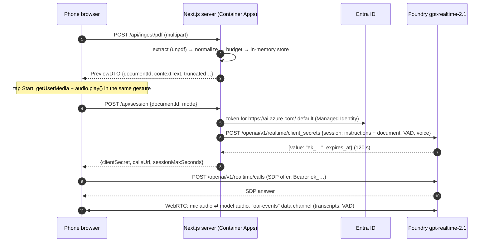

# Talk to a Document or YouTube Video

Mobile-first web app: upload a PDF (or paste a YouTube link or a transcript), then hold a live voice
conversation about it. The browser talks to the Realtime model directly over **WebRTC**. The server
only ingests the document and mints a short-lived session secret with **Managed Identity**, so there
are no API keys anywhere.

Built spec-first with [GitHub Spec Kit](https://github.com/github/spec-kit): see
[`specs/001-voice-doc-chat/`](specs/001-voice-doc-chat/) for the spec, plan, research, contracts and
tasks.

## Live demo

**https://ca-web-czb5frz44vkv6.thankfuldune-9c54b32a.canadacentral.azurecontainerapps.io**

Open it on a phone, load a PDF, tap **Start voice chat**, allow the microphone, and ask a question.
Interrupt the assistant at any time by talking over it.

## Features

- **PDF upload** (≤ 25 MB, text-based) with progress, then a collapsible preview of the extracted text.
- **Voice conversation** with the Realtime API: server VAD (semantic), barge-in, live transcript of
  both sides, mute, stop, and a 15-minute session cap.
- **Clear errors** for every edge case: password-protected, scanned/image-only, corrupt, oversized and
  non-PDF files; expired documents; busy voice service.
- **YouTube**: paste any youtube.com, youtu.be, Shorts, embed or live link (`&t=`, `&list=`, `si=`
  are fine). Captions become the document, with title, duration and caption language in the
  preview. If captions can't be fetched, the app offers **Paste transcript** instead.
- **Text chat fallback**: the same Realtime session in text mode when the microphone is denied or
  missing, or when you tap the keyboard button. You can also type in a voice session.
- **Long documents** are cut at a paragraph or sentence boundary to fit the model's context, with a
  visible "Using 42% of this document (pages 1 to 37)" notice.

### Text mode

The app switches to text automatically, with an explanation, when:

| Situation                          | What you see                                                                          |
| ---------------------------------- | ------------------------------------------------------------------------------------- |
| Microphone permission denied       | "Microphone access was denied, so we switched to text chat", plus how to re-enable it |
| No microphone, or a non-HTTPS page | "No microphone is available, so we switched to text chat"                             |
| Browser without WebRTC             | A message to use a recent browser (text mode also uses WebRTC)                        |

Text mode uses the same model and session with `output_modalities: ["text"]`, no turn detection,
and a receive-only audio transceiver, so no microphone is needed.

To turn the microphone back on:

- **iPhone (Safari)**: Settings → Apps → Safari → Microphone → Allow, or tap **aA** in the address bar
  → Website Settings → Microphone. Then reload.
- **Android (Chrome)**: tap the lock or tune icon in the address bar → Permissions → Microphone →
  Allow. Then reload.

### YouTube in the hosted app

YouTube blocks most cloud and datacenter IPs from reading captions: the player answers
`LOGIN_REQUIRED` / "confirm you're not a bot", or 429. Azure egress is affected. The app therefore
uses a **provider chain** (`src/server/ingestion/youtube/`):

| Order | Provider                                            | Where it works                 | Notes                                                                                     |
| ----- | --------------------------------------------------- | ------------------------------ | ----------------------------------------------------------------------------------------- |
| 1     | `direct` (`youtube-transcript-plus`, Innertube API) | locally and on residential IPs | free; usually blocked in Azure                                                            |
| 2     | `supadata` (caption API)                            | anywhere                       | optional: set `ENABLE_SUPADATA=true` and store the key in Key Vault as `supadata-api-key` |
| 3     | **Paste transcript** (UI)                           | always                         | YouTube → description → _Show transcript_ → copy → paste                                  |

Definitive answers stop the chain (no captions, private or removed video). Blocked or transient
failures move on to the next provider, and when all fail the UI switches to the paste tab with an
explanation.

Trade-offs considered:

| Option                            | Cost                           | Why not the default                                 |
| --------------------------------- | ------------------------------ | --------------------------------------------------- |
| Residential proxy (e.g. Webshare) | about $3.50/GB plus a secret   | another moving part; still hit by PoToken checks    |
| Caption API (Supadata)            | free tier 100/month, then paid | third-party dependency; wired in but off by default |
| Paste transcript                  | free                           | one extra step for the user, but always works       |

To enable Supadata on Azure:

```bash
az keyvault secret set --vault-name "$(azd env get-value AZURE_KEY_VAULT_NAME)" \
  --name supadata-api-key --value "<key>"
azd env set ENABLE_SUPADATA true && azd provision
```

## Architecture



Key points:

- **Audio never touches our server.** The server is plain HTTP and scales on request count.
- **Instructions are built on the server** from the stored document; the client can't send a prompt.
- **No keys:** `DefaultAzureCredential` uses the user-assigned identity in Azure and `az login`
  locally. Local auth is disabled on the Foundry account and on Application Insights.

Module map (`src/`):

| Folder                  | Role                                                                                              |
| ----------------------- | ------------------------------------------------------------------------------------------------- |
| `app/`                  | UI shell and thin route handlers (`/api/ingest/*`, `/api/session`, `/api/health`)                 |
| `server/`               | Server-only: env, ingestion (PDF, YouTube, budget), document store, realtime providers, telemetry |
| `client/`               | Browser-only logic, no React: WebRTC connection, event schemas, reducer, session controller       |
| `components/`, `hooks/` | React UI and the `useVoiceSession` hook                                                           |
| `shared/`               | The only code both sides import: zod schemas, error codes, user messages                          |

## Getting started (local)

Prerequisites: Node.js 24, Azure CLI, Azure Developer CLI (`azd`) 1.35+.

```bash
az login
azd auth login
azd up                      # provisions infra/ and deploys; grants your user access to the model
cp .env.example .env.local
azd env get-values | grep -E '^AZURE_OPENAI_' >> .env.local   # endpoint + deployment names
npm ci
npm run dev                 # http://localhost:3000 (the mic works on localhost)
```

No API key is needed: the dev server uses your `az login` identity, which `azd provision` granted
**Cognitive Services OpenAI User** on the Foundry account.

### Configuration

| Variable                                | Required | Default                  | Notes                                     |
| --------------------------------------- | -------- | ------------------------ | ----------------------------------------- |
| `REALTIME_PROVIDER`                     | no       | `azure`                  | `azure` or `openai`                       |
| `AZURE_OPENAI_ENDPOINT`                 | azure    |                          | `https://<resource>.openai.azure.com`     |
| `AZURE_OPENAI_REALTIME_DEPLOYMENT`      | no       | `gpt-realtime-2.1`       | deployment name                           |
| `AZURE_OPENAI_TRANSCRIBE_DEPLOYMENT`    | no       | `gpt-4o-mini-transcribe` | user-speech transcription                 |
| `OPENAI_API_KEY`                        | openai   |                          | server-only; Key Vault reference in Azure |
| `OPENAI_REALTIME_MODEL`                 | no       | `gpt-realtime-2.1`       |                                           |
| `SUPADATA_API_KEY`                      | no       |                          | optional YouTube caption API (hosted app) |
| `APPLICATIONINSIGHTS_CONNECTION_STRING` | no       |                          | telemetry; Entra auth                     |

The app refuses to start if `AZURE_OPENAI_API_KEY` is set: keyless auth only.

## Deployment

Everything is Bicep ([Azure Verified Modules](https://aka.ms/avm)) deployed with `azd`:

- Container Apps: environment plus app, with sticky sessions and 1 to 3 replicas.
- Container Registry, pulled with the managed identity.
- Foundry (AI Services) with `gpt-realtime-2.1` and `gpt-4o-mini-transcribe` deployments.
- Key Vault (RBAC), Log Analytics and Application Insights.
- A user-assigned managed identity and all role assignments.

```bash
azd up                                       # first time
azd env set AZURE_FOUNDRY_LOCATION eastus2   # optional: move only the model if needed
```

CI/CD:

- [`ci.yml`](.github/workflows/ci.yml) runs on every PR: lint, typecheck, unit + integration tests,
  build, Playwright (iPhone 15 WebKit and Pixel 7 Chromium), and a gitleaks scan of the full history.
- [`deploy.yml`](.github/workflows/deploy.yml) runs on every push to `main`: `azd provision` +
  `azd deploy` over **OIDC** (a federated credential set up by `azd pipeline config`, no client
  secret), then a health check that waits for the new commit SHA.

## Testing

```bash
npm test            # Vitest: unit + route integration tests (fixtures generated on the fly)
npm run test:e2e    # Playwright on iPhone 15 (WebKit) and Pixel 7 (Chromium) with a fake realtime transport
npm run fixtures    # regenerate test PDFs (text, 300 pages, scanned, encrypted, corrupt, not-a-PDF)
```

Real audio can't be automated, so [quickstart.md](specs/001-voice-doc-chat/quickstart.md) has the
manual device checklist.

## License

[MIT](LICENSE)
