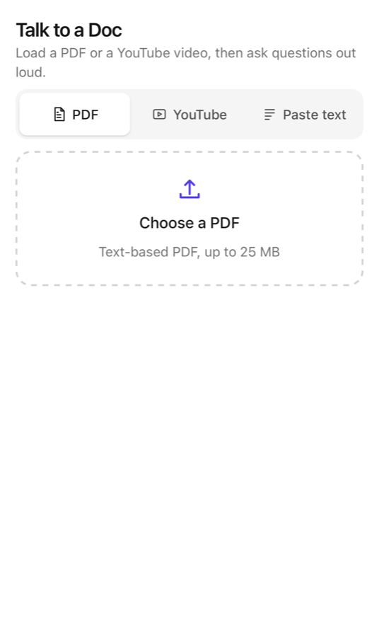
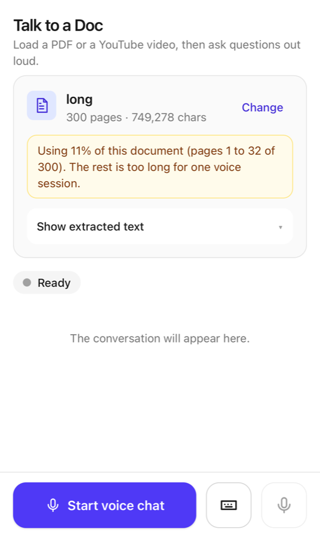
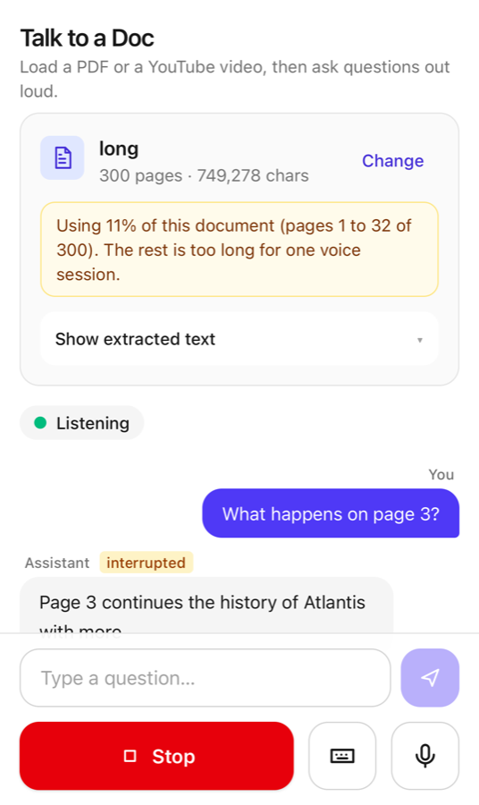
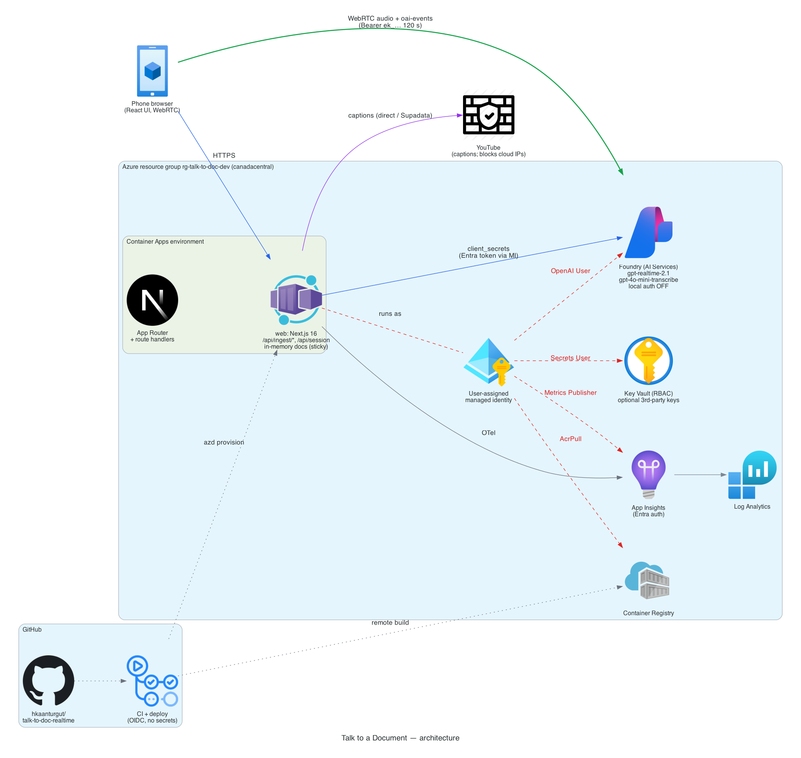
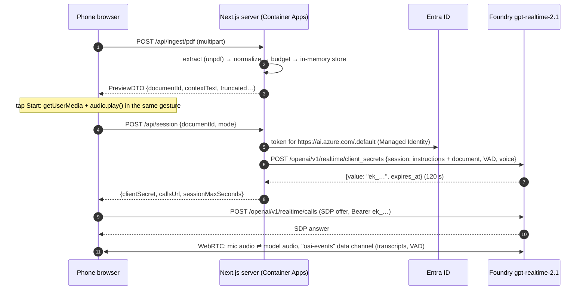

# Talk to a Document or YouTube Video

Mobile-first web app: upload a PDF (or paste a YouTube link or a transcript), then hold a live voice
conversation about it. The browser talks to the Realtime model directly over **WebRTC**. The server
only ingests the document and mints a short-lived session secret with **Managed Identity**, so there
are no API keys anywhere.

Built spec-first with [GitHub Spec Kit](https://github.com/github/spec-kit): see
[`specs/001-voice-doc-chat/`](specs/001-voice-doc-chat/) for the spec, plan, research, contracts and
tasks.

## Live demo

**https://ca-web-czb5frz44vkv6.thankfuldune-9c54b32a.canadacentral.azurecontainerapps.io**

Open it on a phone, load a PDF, tap **Start voice chat**, allow the microphone, and ask a question.
Interrupt the assistant at any time by talking over it. Add `?debug=1` to see reply and
interruption latency (p50/p90).

**Walkthrough video**: _link to be added_.

| Choose a source                                       | Preview with truncation notice                   | Live conversation with barge-in            |
| ----------------------------------------------------- | ------------------------------------------------ | ------------------------------------------ |
|  |  |  |

Dark mode follows the system setting ([screenshots](docs/screenshots/)).

## Features

- **PDF upload** (≤ 25 MB, text-based) with progress, then a collapsible preview of the extracted text.
- **Voice conversation** with the Realtime API: server VAD (semantic), barge-in, live transcript of
  both sides, mute, stop, and a 15-minute session cap.
- **Clear errors** for every edge case: password-protected, scanned/image-only, corrupt, oversized and
  non-PDF files; expired documents; busy voice service.
- **YouTube**: paste any youtube.com, youtu.be, Shorts, embed or live link (`&t=`, `&list=`, `si=`
  are fine). Captions become the document, with title, duration and caption language in the
  preview. If captions can't be fetched, the app offers **Paste transcript** instead.
- **Text chat fallback**: the same Realtime session in text mode when the microphone is denied or
  missing, or when you tap the keyboard button. You can also type in a voice session.
- **Long documents** are cut at a paragraph or sentence boundary to fit the model's context, with a
  visible "Using 42% of this document (pages 1 to 37)" notice.

### Text mode

The app switches to text automatically, with an explanation, when:

| Situation                          | What you see                                                                          |
| ---------------------------------- | ------------------------------------------------------------------------------------- |
| Microphone permission denied       | "Microphone access was denied, so we switched to text chat", plus how to re-enable it |
| No microphone, or a non-HTTPS page | "No microphone is available, so we switched to text chat"                             |
| Browser without WebRTC             | A message to use a recent browser (text mode also uses WebRTC)                        |

Text mode uses the same model and session with `output_modalities: ["text"]`, no turn detection,
and a receive-only audio transceiver, so no microphone is needed.

To turn the microphone back on:

- **iPhone (Safari)**: Settings → Apps → Safari → Microphone → Allow, or tap **aA** in the address bar
  → Website Settings → Microphone. Then reload.
- **Android (Chrome)**: tap the lock or tune icon in the address bar → Permissions → Microphone →
  Allow. Then reload.

### YouTube in the hosted app

YouTube blocks most cloud and datacenter IPs from reading captions: the player answers
`LOGIN_REQUIRED` / "confirm you're not a bot", or 429. Azure egress is affected. The app therefore
uses a **provider chain** (`src/server/ingestion/youtube/`):

| Order | Provider                                            | Where it works                 | Notes                                                                                     |
| ----- | --------------------------------------------------- | ------------------------------ | ----------------------------------------------------------------------------------------- |
| 1     | `direct` (`youtube-transcript-plus`, Innertube API) | locally and on residential IPs | free; usually blocked in Azure                                                            |
| 2     | `supadata` (caption API)                            | anywhere                       | optional: set `ENABLE_SUPADATA=true` and store the key in Key Vault as `supadata-api-key` |
| 3     | **Paste transcript** (UI)                           | always                         | YouTube → description → _Show transcript_ → copy → paste                                  |

Definitive answers stop the chain (no captions, private or removed video). Blocked or transient
failures move on to the next provider, and when all fail the UI switches to the paste tab with an
explanation.

Trade-offs considered:

| Option                            | Cost                           | Why not the default                                 |
| --------------------------------- | ------------------------------ | --------------------------------------------------- |
| Residential proxy (e.g. Webshare) | about $3.50/GB plus a secret   | another moving part; still hit by PoToken checks    |
| Caption API (Supadata)            | free tier 100/month, then paid | third-party dependency; wired in but off by default |
| Paste transcript                  | free                           | one extra step for the user, but always works       |

To enable Supadata on Azure:

```bash
az keyvault secret set --vault-name "$(azd env get-value AZURE_KEY_VAULT_NAME)" \
  --name supadata-api-key --value "<key>"
azd env set ENABLE_SUPADATA true && azd provision
```

### Poor networks, background and device changes

| Situation                                                     | Behavior                                                                                                                                                                                                                                  |
| ------------------------------------------------------------- | ----------------------------------------------------------------------------------------------------------------------------------------------------------------------------------------------------------------------------------------- |
| Network drop (offline event, data channel closed, ICE failed) | Status shows **Reconnecting** at once. Each retry gets a fresh secret and a new peer connection, after 1, 2, 4, 8, then 8 s. The last turns (≤ 40, ≤ 8,000 chars) go back to the model as escaped history, so the conversation continues. |
| ICE `disconnected`                                            | 2 s grace period first, since it often recovers on its own                                                                                                                                                                                |
| Network back (`online`)                                       | Retries immediately instead of waiting for the next backoff step                                                                                                                                                                          |
| Still down after 30 s                                         | **Disconnected**, with a Reconnect button and the transcript kept. Text mode stays available.                                                                                                                                             |
| Document expired during a reconnect                           | "This document has expired. Load it again to continue."                                                                                                                                                                                   |
| App in the background for more than 30 s                      | The session ends cleanly; on return you see "Session paused while the app was in the background". Shorter periods are left alone.                                                                                                         |
| Microphone removed (e.g. Bluetooth headset off)               | The mic is re-acquired and swapped in with `RTCRtpSender.replaceTrack` (no renegotiation). If that fails, the app switches to text.                                                                                                       |
| 15-minute cap                                                 | Countdown in the last 2 minutes, then the session ends. Reconnects do not reset it.                                                                                                                                                       |

## Architecture



Source: [`docs/architecture/diagram.py`](docs/architecture/diagram.py) (diagrams as code). The voice
session handshake:



Key points:

- **Audio never touches our server.** The server is plain HTTP and scales on request count.
- **Instructions are built on the server** from the stored document; the client can't send a prompt.
- **No keys:** `DefaultAzureCredential` uses the user-assigned identity in Azure and `az login`
  locally. Local auth is disabled on the Foundry account and on Application Insights.

Module map (`src/`):

| Folder                  | Role                                                                                              |
| ----------------------- | ------------------------------------------------------------------------------------------------- |
| `app/`                  | UI shell and thin route handlers (`/api/ingest/*`, `/api/session`, `/api/health`)                 |
| `server/`               | Server-only: env, ingestion (PDF, YouTube, budget), document store, realtime providers, telemetry |
| `client/`               | Browser-only logic, no React: WebRTC connection, event schemas, reducer, session controller       |
| `components/`, `hooks/` | React UI and the `useVoiceSession` hook                                                           |
| `shared/`               | The only code both sides import: zod schemas, error codes, user messages                          |

### Key decisions

Each one has the alternatives it beat in [research.md](specs/001-voice-doc-chat/research.md).

| Decision                                                                           | Why                                                                              | Research                                                                                                                                                                |
| ---------------------------------------------------------------------------------- | -------------------------------------------------------------------------------- | ----------------------------------------------------------------------------------------------------------------------------------------------------------------------- |
| Browser ⇄ model over WebRTC; the server only mints a 120 s ephemeral secret        | lowest latency, no audio through our server, documented GA flow                  | [R2](specs/001-voice-doc-chat/research.md#r2-ephemeral-token-and-webrtc-handshake-azure-ga-api)                                                                         |
| `gpt-realtime-2.1` on Azure (Foundry), with a one-variable switch to OpenAI direct | keyless Managed Identity; better barge-in and noise handling than `gpt-realtime` | [R1](specs/001-voice-doc-chat/research.md#r1-realtime-model-and-deployment), [R3](specs/001-voice-doc-chat/research.md#r3-provider-toggle-realtime_providerazureopenai) |
| Semantic VAD with `interrupt_response`, near-field noise reduction                 | natural turn-taking; the server truncates audio on barge-in                      | [R4](specs/001-voice-doc-chat/research.md#r4-session-behavior-vad-interruption-transcripts-text-mode)                                                                   |
| Text fallback = the same Realtime session with text output                         | one model, one prompt, one security path                                         | [R4](specs/001-voice-doc-chat/research.md#r4-session-behavior-vad-interruption-transcripts-text-mode)                                                                   |
| Whole document in the instructions (no RAG), cut to a 20k-token budget             | the brief excludes chunking; the cut is visible to the user                      | [R6](specs/001-voice-doc-chat/research.md#r6-context-budget-and-truncation)                                                                                             |
| In-memory store with sticky sessions behind a `DocumentStore` interface            | the brief allows in-memory; Redis is a drop-in later                             | [R10](specs/001-voice-doc-chat/research.md#r10-server-side-state-and-scaling)                                                                                           |
| Bicep (AVM) + azd, GitHub Actions over OIDC                                        | everything reproducible, no secrets in CI                                        | [R11](specs/001-voice-doc-chat/research.md#r11-infrastructure-identity-and-cicd)                                                                                        |

### Security model

- **Identity**: the container app runs as a user-assigned managed identity with only these roles:
  OpenAI User (Foundry), AcrPull, Key Vault Secrets User and Monitoring Metrics Publisher. Local
  auth is **off** on Foundry and App Insights, so no key exists that could leak.
- **Ephemeral secrets**: the browser only ever sees an `ek_…` secret that expires in 120 s and is
  bound to a session config the server built. An expired secret gets one automatic re-mint.
- **Server-built prompt**: the instructions come from the server-stored document. Client history
  (used on reconnect) is length-capped, escaped, and wrapped as data. The model has no tools, so
  prompt injection in a document can at worst produce an off-topic answer.
- **Inputs**: zod on every route; PDF magic-byte, size (25 MB) and timeout checks; pasted text is
  capped at 400k chars; YouTube URLs are host-allowlisted (no SSRF).
- **Abuse**: per-IP token buckets (10 sessions and 20 ingests per minute), keyed on the last
  `x-forwarded-for` hop, which the ingress appends and the client can't spoof.
- **Headers**: CSP (`connect-src` limited to self and the provider domains), `Permissions-Policy:
microphone=(self)`, `nosniff`, `X-Frame-Options: DENY`, strict referrer.
- **Privacy**: PDF bytes are never written to disk; only extracted text is kept in memory for 60
  minutes of inactivity. Telemetry uses an allowlist of property keys: no document text, history or
  tokens.
- **Supply chain**: gitleaks scans the full history in CI; dependencies are pinned in the lockfile.

## Trade-offs and limitations

- **Context**: Azure lists 32k input tokens for realtime models, so the app keeps a 20k-token
  (80,000-char) document budget. Longer documents are cut at a boundary and the UI says how much is
  used. A 300-page PDF uses about 10%. There is no RAG, by design of the brief.
- **YouTube in the cloud**: captions are blocked from Azure IPs. The hosted app falls back to
  _Paste transcript_ unless the optional caption API is enabled ([details](#youtube-in-the-hosted-app)).
- **In-memory documents**: they are lost on a replica restart (the user sees "load it again"). Sticky
  sessions keep a visitor on one replica; Redis would remove the limit.
- **Per-replica rate limits**: the effective limit is up to 3x with 3 replicas.
- **Client-enforced 15-minute cap**: a modified client could keep a session up to the service's
  60-minute limit; a server-side cap would need a media relay.
- **Static CSP wildcard**: `https://*.openai.azure.com` because headers are fixed at build time; a
  nonce-based runtime CSP would need middleware.
- **No OCR**: scanned PDFs get a clear message. Azure Document Intelligence would be the add-on.
- **Text mode needs WebRTC too**: very old browsers get a message instead of chat.

## Getting started (local)

Prerequisites: Node.js 24, Azure CLI, Azure Developer CLI (`azd`) 1.35+.

```bash
az login
azd auth login
azd up                      # provisions infra/ and deploys; grants your user access to the model
cp .env.example .env.local
azd env get-values | grep -E '^AZURE_OPENAI_' >> .env.local   # endpoint + deployment names
npm ci
npm run dev                 # http://localhost:3000 (the mic works on localhost)
```

No API key is needed: the dev server uses your `az login` identity, which `azd provision` granted
**Cognitive Services OpenAI User** on the Foundry account.

### Configuration

| Variable                                | Required | Default                  | Notes                                     |
| --------------------------------------- | -------- | ------------------------ | ----------------------------------------- |
| `REALTIME_PROVIDER`                     | no       | `azure`                  | `azure` or `openai`                       |
| `AZURE_OPENAI_ENDPOINT`                 | azure    |                          | `https://<resource>.openai.azure.com`     |
| `AZURE_OPENAI_REALTIME_DEPLOYMENT`      | no       | `gpt-realtime-2.1`       | deployment name                           |
| `AZURE_OPENAI_TRANSCRIBE_DEPLOYMENT`    | no       | `gpt-4o-mini-transcribe` | user-speech transcription                 |
| `OPENAI_API_KEY`                        | openai   |                          | server-only; Key Vault reference in Azure |
| `OPENAI_REALTIME_MODEL`                 | no       | `gpt-realtime-2.1`       |                                           |
| `SUPADATA_API_KEY`                      | no       |                          | optional YouTube caption API (hosted app) |
| `APPLICATIONINSIGHTS_CONNECTION_STRING` | no       |                          | telemetry; Entra auth                     |

The app refuses to start if `AZURE_OPENAI_API_KEY` is set: keyless auth only.

## Deployment

Everything is Bicep ([Azure Verified Modules](https://aka.ms/avm)) deployed with `azd`:

- Container Apps: environment plus app, with sticky sessions and 1 to 3 replicas.
- Container Registry, pulled with the managed identity.
- Foundry (AI Services) with `gpt-realtime-2.1` and `gpt-4o-mini-transcribe` deployments.
- Key Vault (RBAC), Log Analytics and Application Insights.
- A user-assigned managed identity and all role assignments.

```bash
azd up                                       # first time
azd env set AZURE_FOUNDRY_LOCATION eastus2   # optional: move only the model if needed
```

CI/CD:

- [`ci.yml`](.github/workflows/ci.yml) runs on every PR: lint, typecheck, unit + integration tests,
  build, Playwright (iPhone 15 WebKit and Pixel 7 Chromium), and a gitleaks scan of the full history.
- [`deploy.yml`](.github/workflows/deploy.yml) runs on every push to `main`: `azd provision` +
  `azd deploy` over **OIDC** (a federated credential set up by `azd pipeline config`, no client
  secret), then a health check that waits for the new commit SHA.

## Testing

```bash
npm test            # Vitest: unit + route integration tests (fixtures generated on the fly)
npm run test:e2e    # Playwright on iPhone 15 (WebKit) and Pixel 7 (Chromium) with a fake realtime transport
npm run fixtures    # regenerate test PDFs (text, 300 pages, scanned, encrypted, corrupt, not-a-PDF)
```

What runs where:

| Layer                | Count | Covers                                                                                                                                                                                                |
| -------------------- | ----- | ----------------------------------------------------------------------------------------------------------------------------------------------------------------------------------------------------- |
| Unit (Vitest)        | ~200  | URL parser, normalizer, budget, PDF edge cases, error mapping, rate limiter, store TTL/LRU, instruction escaping, event reducer, controller (reconnect, background, device change, text fallback)     |
| Integration (Vitest) | ~40   | real route handlers: ingest PDF/YouTube/text, session (no key leak, rate limits, history escaping)                                                                                                    |
| E2E (Playwright)     | 34    | both mobile profiles: upload → preview → voice with a fake transport, barge-in, mute, mic denied → text, YouTube → paste, reconnect and give-up (clock API), axe accessibility in light and dark mode |

Real audio can't be automated, so [quickstart.md](specs/001-voice-doc-chat/quickstart.md) has the
manual device checklist, and [docs/eval/questions.md](docs/eval/questions.md) has the grounding
eval (10/10 in text mode on the deployed app).

## How AI tools were used

- **Spec-driven development with GitHub Spec Kit**: `/speckit-constitution` → `specify` → `clarify`
  → `plan` → `tasks` → `analyze` → `implement`. The owner reviewed and approved the spec, plan and
  task list before any code was written. The `analyze` step (a separate consistency pass) found 34
  issues in the first draft, including 5 constitution gaps, which were fixed before implementation
  ([analysis.md](specs/001-voice-doc-chat/analysis.md)).
- **Claude Code** implemented the tasks phase by phase: one PR per checkpoint, CI green before each
  merge, and every task checked off in [tasks.md](specs/001-voice-doc-chat/tasks.md) with notes where
  reality differed from the plan.
- **Verified against the real service, not assumed**: the riskiest assumptions (WebRTC from
  canadacentral, text mode with no mic, an 18k-token prompt, a 24 MB upload through the ingress, the
  live YouTube behavior from Azure) were each tested against the deployed resources. The results are
  recorded in tasks.md (T028) and the PR descriptions.
- **Reviewed by hand**: the Bicep role assignments, the token flow and prompt escaping, the CSP, and
  the error catalog wording.

## Cost notes

Idle cost is small: Container Apps with 1 always-on replica (0.5 vCPU), ACR Basic (~$5/month), and
Log Analytics at low volume. Model use is pay-per-token: realtime audio is the main cost driver,
bounded by the 15-minute session cap and the session rate limit. Tear everything down with
`azd down --purge`.

## License

[MIT](LICENSE)
