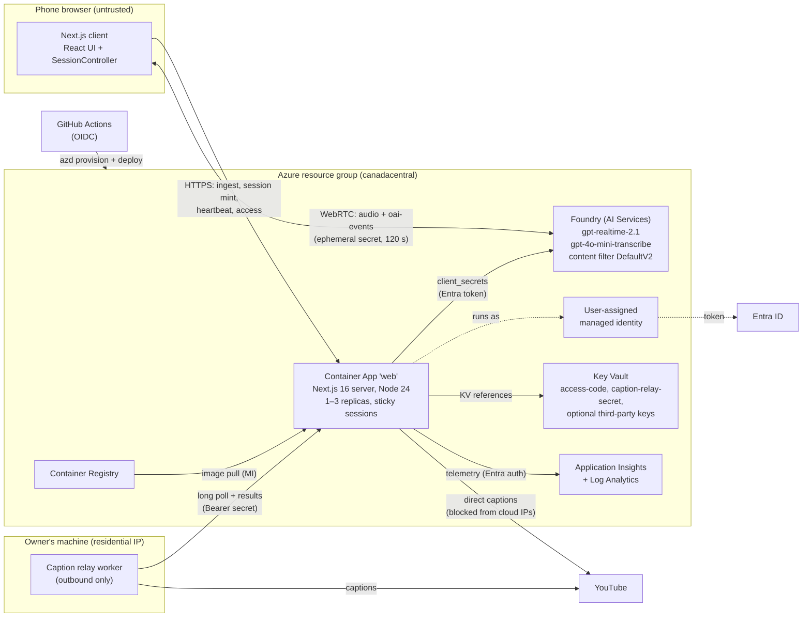

# High-Level Design: Talk to a Document

**Status**: as built on `main` (features 001 to 003), October 2026. **Audience**: reviewers and
maintainers. The low-level detail is in [LLD.md](LLD.md); every significant decision, with the options
it beat, is in [DECISIONS.md](DECISIONS.md).

## 1. Purpose and scope

A mobile-first web app. The user loads a source document, then holds a live voice conversation about
it, with a live transcript and the option to interrupt. The source can be:

- a PDF (up to 25 MB, text-based),
- a YouTube link (its captions become the document), or
- pasted text (the fallback for YouTube).

**In scope** ([spec 001](../../specs/001-voice-doc-chat/spec.md)):

- PDF, YouTube and pasted-text ingestion with a collapsible preview and a visible truncation notice.
- Voice conversation with barge-in, mute, stop, and a 15-minute session cap.
- Text chat fallback when there is no microphone.
- Reconnect after network drops.
- Clear messages for every edge case.
- A publicly hosted deployment.

Also in scope:

- **Spec 002**: YouTube on the hosted app, through an owner-run caption relay
  ([spec](../../specs/002-caption-relay/spec.md)).
- **Spec 003**: an access code, conversation guardrails, a cap on concurrent voice conversations and
  cross-site protection ([spec](../../specs/003-access-guardrails/spec.md)).

**Out of scope** (by the brief or by choice):

- user accounts and saved history;
- multi-document chat;
- RAG, chunking or summarization (the whole document goes into the prompt, cut to a budget);
- OCR for scanned PDFs;
- persistent storage.

## 2. System context

Source: [`docs/architecture/diagram.py`](../architecture/diagram.py) (diagrams as code). The same
system as a container diagram:

## 3. Components

| Component                  | Technology                                                                                    | Responsibility                                                                                                                                                                                                                                                         |
| -------------------------- | --------------------------------------------------------------------------------------------- | ---------------------------------------------------------------------------------------------------------------------------------------------------------------------------------------------------------------------------------------------------------------------- |
| **Browser client**         | React 19, Tailwind 4, a framework-free `SessionController`                                    | Source picker, preview, conversation UI. Owns the microphone, the `RTCPeerConnection` and the data channel, the transcript state machine, reconnects, the heartbeat, and the switch to text. It never holds a long-lived credential.                                   |
| **App server**             | Next.js 16 App Router on Node 24, `output: standalone`, in Azure Container Apps (Consumption) | Access gate and origin check (`src/proxy.ts`), ingestion (PDF, YouTube, text), the in-memory document store, building the instructions, minting ephemeral realtime secrets, voice slots, the relay queue, and health.                                                  |
| **Realtime model**         | Azure AI Foundry `gpt-realtime-2.1` (GlobalStandard, 10 units)                                | Speech-to-speech conversation over WebRTC with semantic VAD and barge-in. Also text mode.                                                                                                                                                                              |
| **Transcription model**    | `gpt-4o-mini-transcribe` deployment                                                           | Transcribes the user's speech for the live transcript.                                                                                                                                                                                                                 |
| **Managed identity**       | User-assigned identity                                                                        | The app's only identity. Roles: Cognitive Services OpenAI User (Foundry), AcrPull, Key Vault Secrets User, Monitoring Metrics Publisher.                                                                                                                               |
| **Key Vault**              | RBAC mode                                                                                     | Holds `access-code`, `caption-relay-secret`, and optional `supadata-api-key` and `openai-api-key`. Each is wired to the app as a Container Apps Key Vault reference only when its feature flag is on.                                                                  |
| **Observability**          | Application Insights + Log Analytics, `@azure/monitor-opentelemetry`                          | Custom events and exceptions through an allowlist of property keys: no document text, history or tokens. Local auth is disabled, so ingestion uses Entra.                                                                                                              |
| **Container Registry**     | ACR Basic, `azd` remote build                                                                 | Stores the app image. It is pulled with the managed identity.                                                                                                                                                                                                          |
| **Caption relay worker**   | `tools/caption-relay/` (tsx), on the owner's machine                                          | Long-polls the app for YouTube caption jobs and fetches the captions from a residential IP. Outbound HTTPS only, no listening port.                                                                                                                                    |
| **CI/CD**                  | GitHub Actions: `ci.yml`, `deploy.yml`                                                        | CI runs lint, format, typecheck, unit and integration tests, build, Playwright and a gitleaks full-history scan. Deploy runs `azd provision` and `azd deploy` over an OIDC federated credential (no client secret), then a health check that waits for the commit SHA. |
| **Infrastructure as code** | Bicep with Azure Verified Modules (AVM), `azd`                                                | Every resource and role assignment, reproducible with `azd up`.                                                                                                                                                                                                        |

## 4. Key flows (high level)

Sequence diagrams for each flow are in [LLD.md §5](LLD.md#5-sequence-diagrams).

1. **Access** (when the code is configured). Any page without a valid access cookie redirects to
   `/access`. The user enters the code from the invitation email. The server compares it in constant
   time, sets a signed, HttpOnly cookie valid for 7 days, and sends the user back to the page they
   first asked for. APIs without the cookie return `401`.
2. **Ingest a PDF**. The browser uploads the file as multipart with a progress bar. The server:
   - validates the size and the `%PDF-` magic bytes;
   - extracts the text with `unpdf` (20 s timeout);
   - normalizes it and cuts it to the context budget at a paragraph or sentence boundary;
   - stores it in memory and returns a preview (the text used, its share of the document, the pages).

   The PDF bytes are never written to disk.

3. **Ingest a YouTube video**. The server parses the URL against an allowlist of hosts, then tries a
   provider chain: the direct Innertube fetch, then the caption relay (only if it is online), then
   Supadata (only if a key is configured). If all of them fail, the UI switches to **Paste
   transcript**. Metadata comes from oEmbed.
4. **Voice session**.
   - On the tap, the browser asks for the microphone and calls `POST /api/session` with the document
     id.
   - The server takes a voice slot, builds the instructions from the **stored** document, and gets
     an Entra token with the managed identity.
   - It then calls the provider's `client_secrets` endpoint and returns an ephemeral secret
     (`ek_…`, 120 s) plus the calls URL.
   - The browser posts its SDP offer directly to the model. From then on, audio and events flow
     browser ⇄ model over WebRTC, and the app server is not in the media path.
   - The browser sends a heartbeat every 30 s and releases the slot on stop or page close.
5. **Text mode**. The same session and instructions with `output_modalities: ["text"]`, no turn
   detection, and a receive-only audio transceiver, so no microphone is needed. Used automatically
   when the mic is denied or missing, or when voice is at capacity, and on request.
6. **Reconnect**. On a drop, every retry mints a fresh secret and builds a new peer connection, with
   backoff of 1, 2, 4, 8, then 8 s, for up to 30 s. The voice slot and the 15-minute clock carry over.
   The last turns go back into the instructions as escaped history.

## 5. Non-functional requirements

| Area                 | Requirement (source)                                                                   | How the design meets it                                                                                                                                                                      |
| -------------------- | -------------------------------------------------------------------------------------- | -------------------------------------------------------------------------------------------------------------------------------------------------------------------------------------------- |
| Reply latency        | Spoken reply starts ≤ 1.5 s after the user stops, in 90% of turns (SC-003)             | Direct browser ⇄ model WebRTC; semantic VAD; short answers (`max_output_tokens: 1024`, "2 to 4 sentences"). `?debug=1` shows the p50 and p90 measured from data-channel events.              |
| Barge-in             | Audio stops ≤ 500 ms after the user interrupts, in 90% of cases (SC-004)               | `interrupt_response: true`; on WebRTC the service truncates unplayed audio itself (`output_audio_buffer.cleared`).                                                                           |
| Time to first answer | Under 60 s from opening the app (SC-001); a 10 MB PDF previewed in under 10 s (SC-002) | One-screen flow; extraction on the server; the mic and audio are unlocked in the same tap.                                                                                                   |
| Grounding            | At least 9 of 10 answers correct and grounded (SC-005)                                 | The whole document (up to 20k tokens) goes into the instructions, and the model is told to say so when the answer isn't there. Eval: 10/10 ([docs/eval/questions.md](../eval/questions.md)). |
| Resilience           | Recover from drops of up to 15 s without a reload (SC-006)                             | The reconnect policy above; the transcript is kept; the history is re-sent.                                                                                                                  |
| Mobile               | iOS Safari and Android Chrome at 390 px (SC-008)                                       | Mobile-first layout; Playwright on iPhone 15 (WebKit) and Pixel 7 (Chromium); axe checks in light and dark mode.                                                                             |
| Security             | Zero long-lived credentials on the client or in the repo (SC-009)                      | Managed identity everywhere; ephemeral secrets; Key Vault; OIDC in CI; gitleaks. Details in §6.                                                                                              |
| Privacy              | No document retained beyond 60 minutes of inactivity                                   | In-memory store with an idle TTL and LRU caps; PDF bytes never touch disk; no transcripts stored; telemetry allowlist.                                                                       |
| Cost                 | Bounded spend on a public URL                                                          | Access code, voice cap, the 15-minute server cap, output token cap, deployment capacity, per-IP rate limits. Details in §7.                                                                  |
| Availability         | Demo-grade; no cold start during review                                                | `minReplicas: 1`; liveness and readiness probes on `/api/health`; single-revision mode.                                                                                                      |

## 6. Security model

Threats and controls, from the outside in. Each control's details are in [LLD.md](LLD.md).

| Threat                                       | Control                                                                                                                                                                                                                             |
| -------------------------------------------- | ----------------------------------------------------------------------------------------------------------------------------------------------------------------------------------------------------------------------------------- |
| Strangers spend the voice budget             | Access code gate in `src/proxy.ts`, checked again inside the session and ingest routes. The cookie is HMAC-signed with a key derived from the code, so rotating the code signs out every device. 5 tries per minute per IP.         |
| Credential theft from the client             | The browser only ever sees a 120 s ephemeral secret bound to a session config the server built. Local auth is off on Foundry and App Insights, so there is no key that could leak.                                                  |
| A client sets its own prompt                 | The instructions are built on the server from the stored document; the client sends only a document id, a mode and length-capped history.                                                                                           |
| Prompt injection in a document or history    | Untrusted text is wrapped in delimiter tags, and our own tags inside it are neutralized. The instructions say the material is data. **No tools** are attached, so injected text can at worst cause a wrong answer, never an action. |
| Off-topic or harmful use                     | Scope and decline rules in the instructions, plus Azure's default content filter (`Microsoft.DefaultV2`) on input and output, pinned in Bicep. Eval: 13/13 ([docs/eval/guardrails.md](../eval/guardrails.md)).                      |
| Cross-site request forgery                   | State-changing `/api/*` calls with `Sec-Fetch-Site: cross-site` or a foreign `Origin` get `403`; the cookie is `SameSite=Lax`.                                                                                                      |
| Open redirect after the access screen        | `safeNext()` accepts only same-site paths and rejects `//`, backslashes and control characters.                                                                                                                                     |
| SSRF through YouTube URLs                    | Hosts are allowlisted, and the server only calls fixed YouTube and Supadata hosts.                                                                                                                                                  |
| Malicious uploads                            | Size checks (`content-length` and `file.size`), magic bytes, a 20 s extraction timeout, `pdf.destroy()` always, and zod on every JSON body.                                                                                         |
| Abuse and resource exhaustion                | Per-IP token buckets: 10 sessions, 20 ingests, 5 access tries and 10 relay auth failures per minute, keyed on the last `x-forwarded-for` hop. At most 3 live voice conversations per instance.                                      |
| Exposure of the owner's home machine (relay) | The relay is outbound-only: no port, no tunnel. Its secret is in Key Vault, compared in constant time; `/api/relay/*` returns `404` when the feature is off; results are validated and single-use.                                  |
| Browser hardening                            | CSP (`connect-src` limited to self and the provider domains), `Permissions-Policy: microphone=(self)`, `nosniff`, `X-Frame-Options: DENY`, a strict referrer policy.                                                                |
| Supply chain and leaked secrets              | gitleaks scans the full history in CI; the lockfile is committed; no secrets in GitHub (OIDC).                                                                                                                                      |

## 7. Cost model

| Cost driver                                       | Shape                                          | Bound                                                                                                                                                                                                |
| ------------------------------------------------- | ---------------------------------------------- | ---------------------------------------------------------------------------------------------------------------------------------------------------------------------------------------------------- |
| Realtime audio tokens                             | Pay per token; the main cost                   | Access code (known audience); 3 concurrent voice conversations per instance; the 15-minute cap enforced on renewals and heartbeats; `max_output_tokens: 1024`; the deployment's capacity (10 units). |
| Transcription                                     | Pay per use, small                             | Only while voice is live.                                                                                                                                                                            |
| Container Apps                                    | 1 always-on replica (0.5 vCPU, 1 GiB), up to 3 | The HTTP scale rule at 30 concurrent requests. Audio doesn't pass through the app, so the app scales on request count only.                                                                          |
| ACR Basic, Log Analytics, App Insights, Key Vault | Low fixed or volume-based                      | ACR Basic is about $5 a month; telemetry volume is small (allowlisted events).                                                                                                                       |

Worst case per instance: 3 × 15-minute voice conversations at a time. Teardown: `azd down --purge`.

## 8. Deployment topology

- **One resource group** per `azd` environment (`rg-<env>`), in canadacentral. The Foundry account
  has its own `foundryLocation` parameter, so it can move to another region alone.
- **Container Apps environment** (Consumption, public network access) with one app, `web`:
  - external HTTPS ingress only (`allowInsecure: false`);
  - sticky sessions;
  - single active revision;
  - 1 to 3 replicas;
  - probes on `/api/health`.
- **Default host**: `ca-web-<token>.<env-domain>.canadacentral.azurecontainerapps.io`.
- **Custom domain**: `talk-to-doc.hkaanturgut.com` is being added in `specs/004-custom-domain/`, with
  a free Container Apps managed certificate. It is a subdomain of the owner's existing domain; the
  DNS zone is in Azure. See [DECISIONS.md D-17](DECISIONS.md#d-17-custom-domain).
- **Pipeline**: a push to `main` triggers `deploy.yml`:
  1. log in with OIDC;
  2. `azd provision` (Bicep);
  3. `azd deploy` (ACR remote build, new revision);
  4. smoke test until `/api/health` reports the commit SHA.
- **Feature flags**: repository variables (`ENABLE_ACCESS_CODE`, `ENABLE_CAPTION_RELAY`,
  `ENABLE_SUPADATA`, `ENABLE_OPENAI`, `MAX_VOICE_SESSIONS`) become Bicep parameters. Secrets stay in
  Key Vault and are referenced, never copied.

## 9. Scaling limits

The app is designed for a small review audience. Its state is in process memory, behind interfaces
that a shared store could replace:

| State                              | Where               | Effect with more than one replica                                                                              | Upgrade path                                                  |
| ---------------------------------- | ------------------- | -------------------------------------------------------------------------------------------------------------- | ------------------------------------------------------------- |
| Documents (`DocumentStore`)        | Map in each replica | Sticky sessions keep a visitor on the replica that holds their document; a restart loses it ("load it again"). | Redis behind the same interface                               |
| Rate limits                        | Each replica        | The effective limit is up to 3× with 3 replicas.                                                               | Redis                                                         |
| Voice slots (`VoiceLeases`)        | Each replica        | The cap is per replica (3 each, up to 9 at the maximum of 3 replicas); a restart forgets live slots.           | Redis                                                         |
| Caption relay queue (`RelayQueue`) | Each replica        | Only the replica the relay polls can use it; visitors on another replica get the paste fallback.               | Azure Service Bus, with Entra ID instead of the shared secret |

Audio never passes through the app, so the app's own load is HTTP requests only. The binding limits
are the model deployment's capacity and the voice cap.

## 10. Key decisions

| #                                                                                  | Decision                                                            |
| ---------------------------------------------------------------------------------- | ------------------------------------------------------------------- |
| [D-01](DECISIONS.md#d-01-realtime-model)                                           | `gpt-realtime-2.1` on Azure Foundry, with a switch to OpenAI direct |
| [D-02](DECISIONS.md#d-02-webrtc-from-the-browser-not-a-websocket-relay)            | WebRTC from the browser to the model, not a WebSocket relay         |
| [D-03](DECISIONS.md#d-03-server-minted-ephemeral-secrets)                          | Server-minted 120 s ephemeral secrets with Managed Identity         |
| [D-04](DECISIONS.md#d-04-text-mode-on-the-same-realtime-session)                   | Text mode on the same Realtime session                              |
| [D-05](DECISIONS.md#d-05-whole-document-in-the-prompt-with-a-visible-budget)       | Whole document in the prompt with a visible budget, no RAG          |
| [D-06](DECISIONS.md#d-06-in-memory-state-with-sticky-sessions)                     | In-memory state with sticky sessions                                |
| [D-07](DECISIONS.md#d-07-azure-container-apps)                                     | Azure Container Apps                                                |
| [D-08](DECISIONS.md#d-08-bicep-avm-azd-and-oidc)                                   | Bicep (AVM) + `azd`, GitHub Actions over OIDC                       |
| [D-09](DECISIONS.md#d-09-pdf-extraction-with-unpdf)                                | PDF extraction with `unpdf`                                         |
| [D-10](DECISIONS.md#d-10-youtube-provider-chain-with-a-paste-fallback)             | YouTube provider chain with a paste fallback                        |
| [D-11](DECISIONS.md#d-11-outbound-only-caption-relay)                              | Outbound-only caption relay                                         |
| [D-12](DECISIONS.md#d-12-access-code-not-sign-in)                                  | Access code, not sign-in                                            |
| [D-13](DECISIONS.md#d-13-gate-in-srcproxyts)                                       | Gate in `src/proxy.ts`                                              |
| [D-14](DECISIONS.md#d-14-guardrails-in-the-prompt-plus-the-default-content-filter) | Guardrails in the prompt plus the default content filter            |
| [D-15](DECISIONS.md#d-15-voice-slots-with-heartbeats)                              | Voice slots with heartbeats                                         |
| [D-16](DECISIONS.md#d-16-origin-check-instead-of-csrf-tokens)                      | Origin check instead of CSRF tokens                                 |
| [D-17](DECISIONS.md#d-17-custom-domain)                                            | Custom domain on a subdomain of the owner's existing domain         |
